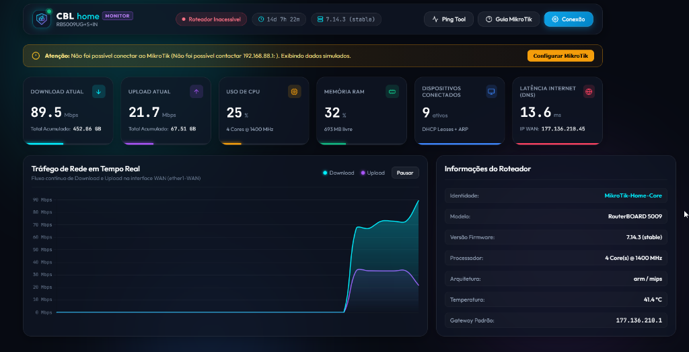
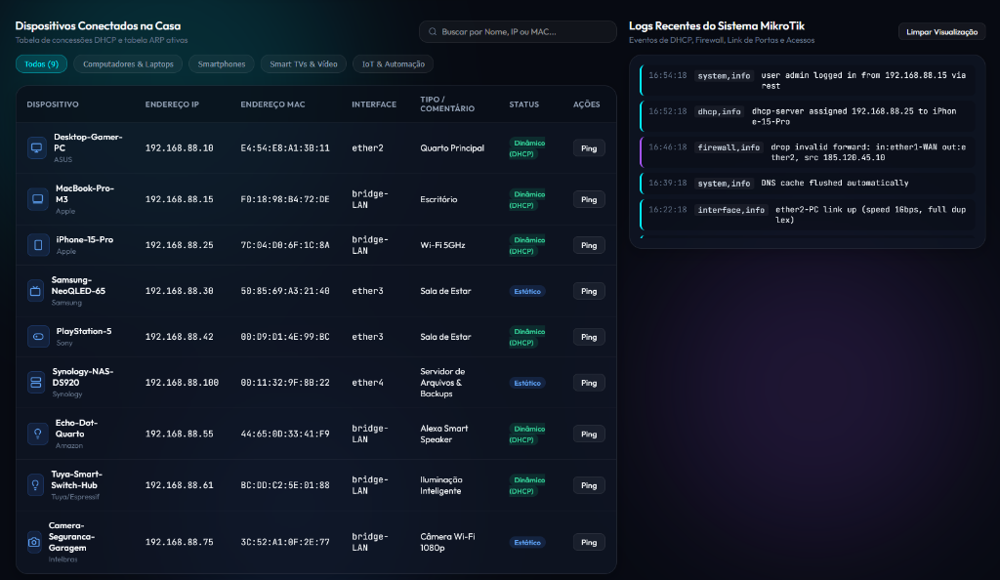
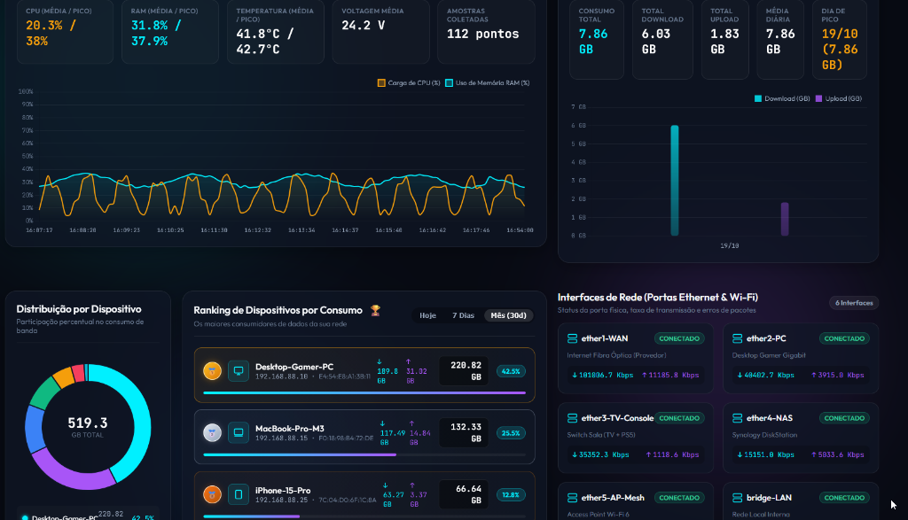
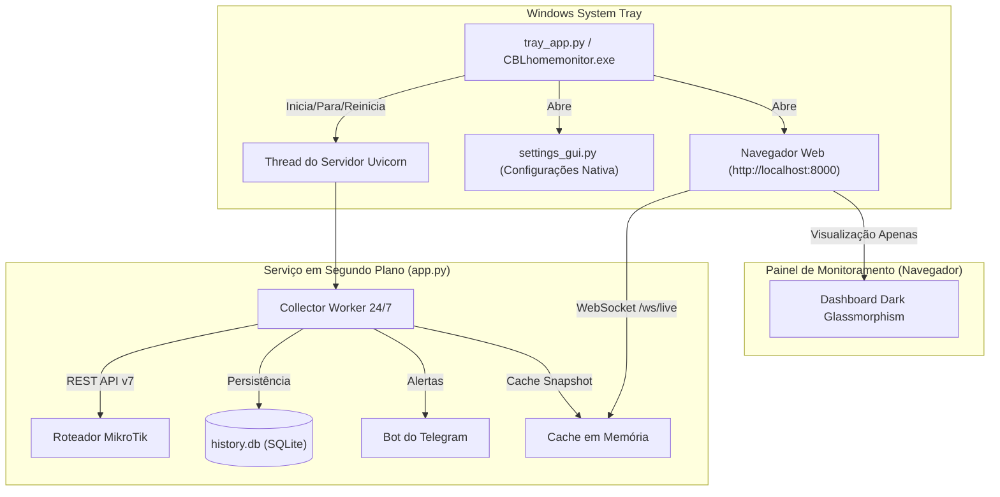

<div align="center">
  
  <h1>CBLhomemonitor ⚡</h1>
  <p><strong>Monitor de Rede Residencial de Alta Performance para MikroTik RouterOS v7+</strong></p>
  <p>Serviço autônomo em segundo plano para Windows com aplicativo na barra de tarefas (System Tray), painel em tempo real e instalador facilitado.</p>

  <p>
    <a href="https://github.com/luisviscardo/CBLhomemonitor/releases/latest/download/CBLhomemonitor-v1.2.0-windows-x64.zip">
      
    </a>
    &nbsp;
    <a href="https://github.com/luisviscardo/CBLhomemonitor/releases/latest">
      
    </a>
  </p>
</div>

---

## 🚀 Instalação Rápida no Windows (Recomendado)

Você **não precisa** instalar Python nem configurar nada no terminal. Basta usar a versão pronta da Release:

1. **Baixe a versão pronta:** [**📥 Clique aqui para baixar `CBLhomemonitor-v1.2.0-windows-x64.zip`**](https://github.com/luisviscardo/CBLhomemonitor/releases/latest/download/CBLhomemonitor-v1.2.0-windows-x64.zip) *(ou acesse a [página de Releases](https://github.com/luisviscardo/CBLhomemonitor/releases/latest))*.
2. **Extraia o arquivo `.zip`** em qualquer pasta do seu computador.
3. **Dê um duplo clique em `install.bat`** (ou execute diretamente o `CBLhomemonitor.exe`).

Pronto! O instalador cria os atalhos na sua **Área de Trabalho** e no **Menu Iniciar**, ativa o ícone **⚡** ao lado do relógio do Windows e abre o painel automaticamente em **`http://localhost:8000`**.

<details>
<summary><strong>💻 Opção Alternativa: Executar a partir do Código-Fonte (Desenvolvedores)</strong></summary>

Caso queira rodar diretamente via Python a partir do repositório clonado:

```bash
# 1. Instalar dependências
pip install -r requirements.txt

# 2. Iniciar o serviço com ícone na bandeja do Windows
pythonw tray_app.py
```

Para recompilar o executável autônomo (`dist/CBLhomemonitor/CBLhomemonitor.exe`):
```bash
python build_exe.py
```
</details>

---

## 📸 Telas do Sistema

<div align="center">
  <h4>Painel Principal — Gráfico de Tráfego WAN em Tempo Real & Métricas</h4>
  
  <br/><br/>

  <h4>Dispositivos Conectados na Casa & Logs do RouterOS</h4>
  
  <br/><br/>

  <h4>Histórico de Uso, Telemetria de Hardware (CPU/RAM/Temp) & Ranking de Consumo</h4>
  
</div>

---

## 🌟 Principais Recursos

- **Serviço Contínuo 24/7 em Segundo Plano:** O monitoramento roda como um serviço autônomo, coletando dados, calculando tráfego por aparelho e vigiando a rede mesmo quando o navegador está fechado.
- **Aplicativo na Barra de Tarefas (System Tray do Windows):** Ícone neon discreto ao lado do relógio do Windows com menu de contexto rápido para Iniciar, Parar, Reiniciar, Configurar e Iniciar com o Windows.
- **Painel de Configurações Nativo:** Interface gráfica moderna Dark Glassmorphism para configurar MikroTik (IP, porta, HTTPS, credenciais, WAN) e Telegram com teste de conexão instantâneo.
- **Instalação em 1 Clique:** Pacote executável standalone (`CBLhomemonitor.exe`) acompanhado do instalador automático de atalhos (`install.bat`).
- **Gráficos de Tráfego em Tempo Real (Chart.js):** Fluxo ao vivo de Download e Upload (Mbps) com streaming contínuo via WebSockets.
- **Rastreamento Individual de Consumo (Conntrack):** Coleta individual de bytes enviados e recebidos por cada aparelho via tabela de Connection Tracking do RouterOS.
- **Leaderboard / Ranking de Dispositivos:** Tabela ordenada com medalhas (🥇 Ouro, 🥈 Prata, 🥉 Bronze), barras de progresso proporcionais e formatação adaptativa (KB, MB, GB).
- **Histórico de Uso da Internet (Diário & Mensal):** Gráficos de barras interativos com volume total de dados transferidos (Download e Upload) nos últimos 30 dias ou 12 meses.
- **Histórico de Telemetria de Hardware:** Monitoramento de Carga de CPU (%), Uso de RAM (%), Temperatura (°C) e Voltagem (V) com filtros de *1 Hora*, *6 Horas* e *24 Horas*.
- **Alertas Automatizados via Telegram:** Notificações instantâneas no seu celular para queda do link WAN e superaquecimento do roteador.
- **Banco de Dados Embutido SQLite (`history.db`):** Armazenamento local rápido e leve, sem necessidade de servidores de banco externos.

---

## 🛠️ Opções da Barra de Tarefas (System Tray)

Ao clicar com o **botão direito** no ícone neon do CBLhomemonitor na barra de tarefas (perto do relógio):

* **🟢 Serviço: Rodando / 🔴 Serviço: Parado:** Exibe o status em tempo real.
* **🌐 Abrir Painel de Monitoramento:** Abre o dashboard no seu navegador padrão (`http://localhost:8000`).
* **▶️ Iniciar / ⏹️ Parar / 🔄 Reiniciar Serviço:** Controle total do coletor em segundo plano.
* **⚙️ Configurações do MikroTik...:** Abre a janela nativa para preencher IP, usuário, senha, Telegram e opções de rede com botão de teste de conexão em tempo real.
* **📁 Abrir Pasta do Sistema:** Abre a pasta local onde o banco `history.db` e as configurações residem.
* **🚀 Iniciar com o Windows:** Alterna o início automático do sistema ao ligar o computador.
* **❌ Sair do CBLhomemonitor:** Encerra completamente o serviço e o aplicativo.

---

## ⚙️ Configuração no MikroTik (RouterOS v7+)

O sistema utiliza a **API REST nativa** do RouterOS v7.

### Passo 1: Habilitar o Serviço REST (`www`)
No terminal do seu MikroTik (via Winbox ou SSH):
```routeros
/ip service enable www
```
*(Se preferir HTTPS seguro: `/ip service enable www-ssl`)*

### Passo 2: Criar Usuário de Leitura (Recomendado)
```routeros
/user group add name=monitor-read policy=read,test,api
/user add name=homemonitor group=monitor-read password="SuaSenhaForteAqui"
```

### Passo 3: Configurar pelo App
Clique com o botão direito no ícone do CBLhomemonitor na bandeja do Windows -> **⚙️ Configurações do MikroTik...** (ou pelo botão **Configurações** no topo do painel web), informe o IP, usuário e senha, clique em **Testar Conexão** e em **Salvar e Aplicar**.

---

## 🖥️ Arquitetura do Sistema



---

## 📁 Estrutura do Projeto

- [`tray_app.py`](tray_app.py): Aplicativo da barra de tarefas (System Tray do Windows) com ciclo de vida do serviço e instância única via Mutex.
- [`settings_gui.py`](settings_gui.py): Janela de configuração gráfica nativa com testes assíncronos de conexão com o MikroTik e Telegram.
- [`autostart.py`](autostart.py): Integração com o Registro do Windows para início automático com o sistema.
- [`app.py`](app.py): Backend FastAPI com coletor contínuo em segundo plano (24/7) e difusão WebSocket.
- [`mikrotik_client.py`](mikrotik_client.py): Cliente REST assíncrono para telemetria, tráfego e Connection Tracking do MikroTik.
- [`database.py`](database.py): Camada SQLite com histórico diário, mensal, ranking de aparelhos e telemetria de hardware.
- [`telegram_notifier.py`](telegram_notifier.py): Gestor de alertas automáticos via Telegram.
- [`build_exe.py`](build_exe.py): Script de compilação automatizada com PyInstaller.
- [`install.bat`](install.bat) / [`install.ps1`](install.ps1): Instalador em 1 clique para Windows.
