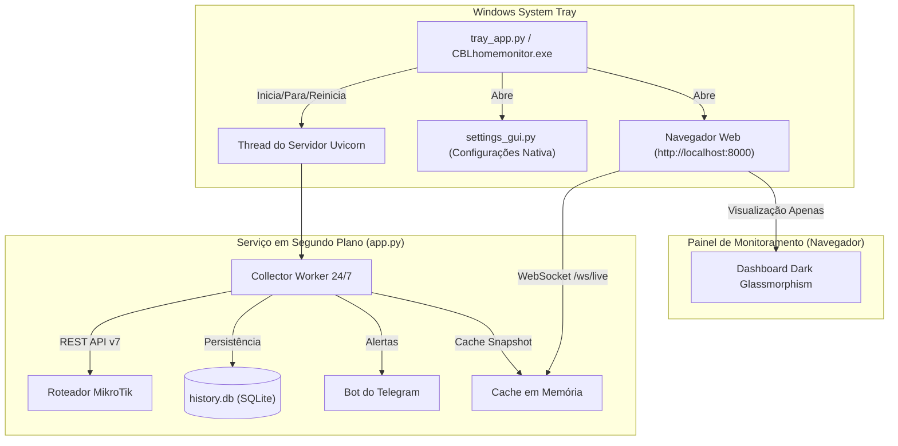

<div align="center">
  
  <h1>CBLhomemonitor ⚡</h1>
  <p><strong>Monitor de Rede Residencial de Alta Performance para MikroTik RouterOS v7+</strong></p>
  <p>Serviço autônomo em segundo plano para Windows com aplicativo na barra de tarefas (System Tray), painel em tempo real e instalador facilitado.</p>
</div>

---

## 🌟 Principais Recursos

- **Serviço Contínuo 24/7 em Segundo Plano:** O monitoramento roda como um serviço autônomo, coletando dados, calculando tráfego por aparelho e vigiando a rede mesmo quando o navegador está fechado.
- **Aplicativo na Barra de Tarefas (System Tray do Windows):** Ícone neon discreto ao lado do relógio do Windows com menu de contexto rápido para Iniciar, Parar, Reiniciar, Configurar e Iniciar com o Windows.
- **Painel de Configurações Nativo:** Interface gráfica moderna Dark Glassmorphism para configurar MikroTik (IP, porta, HTTPS, credenciais, WAN) e Telegram com teste de conexão instantâneo.
- **Instalação em 1 Clique para Usuários Leigos:** Instalador simplificado (`install.bat`) e suporte a executável compilado (`CBLhomemonitor.exe`) e assistente de instalação (`CBLhomemonitor_Setup.exe`).
- **Gráficos de Tráfego em Tempo Real (Chart.js):** Fluxo ao vivo de Download e Upload (Mbps) com streaming contínuo via WebSockets.
- **Rastreamento Individual de Consumo (Conntrack):** Coleta individual de bytes enviados e recebidos por cada aparelho via tabela de Connection Tracking do RouterOS.
- **Leaderboard / Ranking de Dispositivos:** Tabela ordenada com medalhas (🥇 Ouro, 🥈 Prata, 🥉 Bronze), barras de progresso proporcionais e formatação adaptativa (KB, MB, GB).
- **Histórico de Uso da Internet (Diário & Mensal):** Gráficos de barras interativos com volume total de dados transferidos (Download e Upload) nos últimos 30 dias ou 12 meses.
- **Histórico de Telemetria de Hardware:** Monitoramento de Carga de CPU (%), Uso de RAM (%), Temperatura (°C) e Voltagem (V) com filtros de *1 Hora*, *6 Horas* e *24 Horas*.
- **Alertas Automatizados via Telegram:** Notificações instantâneas no seu celular para queda do link WAN e superaquecimento do roteador.
- **Banco de Dados Embutido SQLite (`history.db`):** Armazenamento local rápido e leve, sem necessidade de servidores de banco externos.

---

## 🖥️ Arquitetura do Sistema



---

## 🚀 Como Instalar e Usar

### Opção 1: Instalador em 1 Clique (Recomendado para Usuários Leigos)

1. Baixe ou clone a pasta do projeto.
2. Dê um **duplo clique no arquivo [`install.bat`](file:///C:/Users/lsaqu/.gemini/antigravity-ide/scratch/mikrotik-monitor/install.bat)**.
3. O script irá configurar as dependências, criar os atalhos na Área de Trabalho e no Menu Iniciar, e abrir o ícone do CBLhomemonitor na sua Barra de Tarefas!

### Opção 2: Executar via Terminal / Modo Script

```bash
# 1. Instalar dependências
pip install -r requirements.txt

# 2. Iniciar o serviço com ícone na bandeja do Windows
pythonw tray_app.py
```

O ícone do **CBLhomemonitor ⚡** aparecerá ao lado do relógio do Windows.

---

## 🛠️ Opções da Barra de Tarefas (System Tray)

Ao clicar com o **botão direito** no ícone neon do CBLhomemonitor na barra de tarefas:

* **🟢 Serviço: Rodando / 🔴 Serviço: Parado:** Exibe o status em tempo real.
* **🌐 Abrir Painel de Monitoramento:** Abre o dashboard no seu navegador padrão (`http://localhost:8000`).
* **▶️ Iniciar Serviço:** Liga o serviço de coleta e o servidor local.
* **⏹️ Parar Serviço:** Pausa o serviço.
* **🔄 Reiniciar Serviço:** Recarrega o serviço aplicando novas configurações.
* **⚙️ Configurações do MikroTik...:** Abre a tela nativa para preencher IP, usuário, senha, Telegram e opções de rede com botão de teste de conexão em tempo real.
* **📁 Abrir Pasta do Sistema:** Abre a pasta local onde o banco `history.db` e as configurações residem.
* **🚀 Iniciar com o Windows:** Alterna o início automático do sistema ao ligar o computador.
* **❌ Sair do CBLhomemonitor:** Encerra completamente o serviço e o aplicativo.

---

## 📦 Como Gerar o Executável (.exe) e o Instalador

Para empacotar o projeto em um executável autônomo sem console:

```bash
# Gera o executável na pasta dist/CBLhomemonitor/CBLhomemonitor.exe
python build_exe.py
```

Para gerar o instalador clássico do Windows (`CBLhomemonitor_Setup_v1.2.exe`):
1. Instale o [Inno Setup](https://jrsoftware.org/isdl.php).
2. Abra e compile o arquivo [`installer.iss`](file:///C:/Users/lsaqu/.gemini/antigravity-ide/scratch/mikrotik-monitor/installer.iss).

---

## ⚙️ Configuração no MikroTik (RouterOS v7+)

O sistema utiliza a **API REST nativa** do RouterOS v7.

### Passo 1: Habilitar o Serviço REST (www)
No terminal do seu MikroTik (via Winbox ou SSH):
```routeros
/ip service enable www
```
*(Se preferir HTTPS seguro: `/ip service enable www-ssl`)*

### Passo 2: Criar Usuário de Leitura (Recomendado)
```routeros
/user group add name=monitor-read policy=read,test,api
/user add name=homemonitor group=monitor-read password="SuaSenhaForteAqui"
```

### Passo 3: Configurar pelo App
Abra o menu da bandeja do Windows -> **Configurações do MikroTik...**, digite o IP, usuário e senha, clique em **Testar Conexão** e em **Salvar e Aplicar**.

---

## 📁 Estrutura do Projeto

- [`tray_app.py`](file:///C:/Users/lsaqu/.gemini/antigravity-ide/scratch/mikrotik-monitor/tray_app.py): Aplicativo da barra de tarefas (System Tray do Windows) com ciclo de vida do serviço e instância única via Mutex.
- [`settings_gui.py`](file:///C:/Users/lsaqu/.gemini/antigravity-ide/scratch/mikrotik-monitor/settings_gui.py): Janela de configuração gráfica nativa com testes assíncronos de conexão com o MikroTik e Telegram.
- [`autostart.py`](file:///C:/Users/lsaqu/.gemini/antigravity-ide/scratch/mikrotik-monitor/autostart.py): Integração com o Registro do Windows para início automático com o sistema.
- [`app.py`](file:///C:/Users/lsaqu/.gemini/antigravity-ide/scratch/mikrotik-monitor/app.py): Backend FastAPI com coletor contínuo em segundo plano (24/7) e difusão WebSocket.
- [`mikrotik_client.py`](file:///C:/Users/lsaqu/.gemini/antigravity-ide/scratch/mikrotik-monitor/mikrotik_client.py): Cliente REST assíncrono para telemetria, tráfego e Connection Tracking do MikroTik.
- [`database.py`](file:///C:/Users/lsaqu/.gemini/antigravity-ide/scratch/mikrotik-monitor/database.py): Camada SQLite com histórico diário, mensal, ranking de aparelhos e telemetria de hardware.
- [`telegram_notifier.py`](file:///C:/Users/lsaqu/.gemini/antigravity-ide/scratch/mikrotik-monitor/telegram_notifier.py): Gestor de alertas automáticos via Telegram.
- [`build_exe.py`](file:///C:/Users/lsaqu/.gemini/antigravity-ide/scratch/mikrotik-monitor/build_exe.py): Script de compilação automatizada com PyInstaller.
- [`install.bat`](file:///C:/Users/lsaqu/.gemini/antigravity-ide/scratch/mikrotik-monitor/install.bat): Instalador em 1 clique para Windows.
- [`installer.iss`](file:///C:/Users/lsaqu/.gemini/antigravity-ide/scratch/mikrotik-monitor/installer.iss): Script Inno Setup para gerar `Setup.exe`.
- [`create_icon.py`](file:///C:/Users/lsaqu/.gemini/antigravity-ide/scratch/mikrotik-monitor/create_icon.py): Gerador de ícones oficiais em multi-resolução (.ico e .png).
